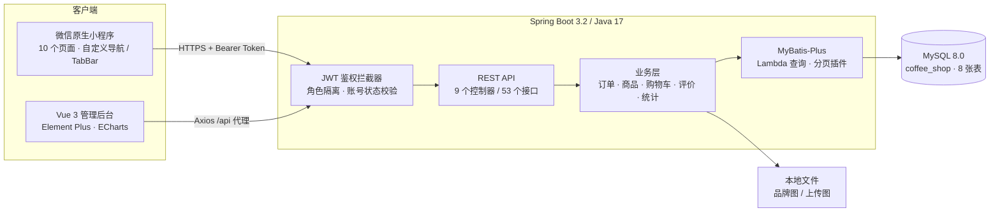
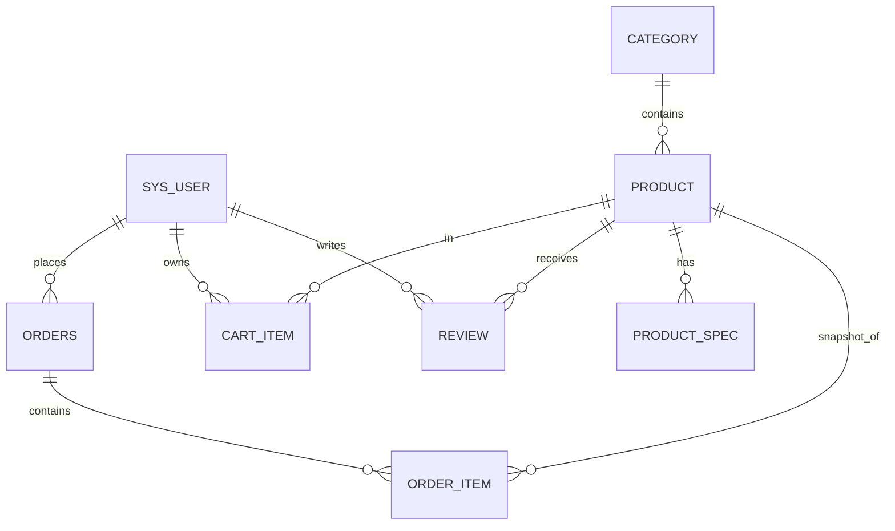

<div align="center">

<h1>GXUFL Coffee Atelier</h1>

<p><strong>广西外国语学院咖啡厅点单系统</strong></p>

<p>微信原生小程序 · Spring Boot · Vue 3 商家管理后台</p>

<p>
  
  
  
  
  
  
  
</p>

</div>

---

## 项目简介

GXUFL Coffee Atelier 是一套面向校园咖啡厅的前后端分离点单系统，以「东南亚六国咖啡」为品牌主题，覆盖用户点单与门店经营两条完整动线。

用户通过微信小程序浏览菜单、选择规格、加入购物车、下单、查看取餐号并完成评价；店员通过 Vue 管理后台处理订单、维护菜单与库存，并查看经营数据。系统采用 **Spring Boot + MyBatis-Plus + MySQL** 提供 REST API，两端通过 JWT 接入，统一响应结构与错误处理。

- **三端工程**：微信原生小程序、Spring Boot 服务端、Vue 3 管理后台
- **完整闭环**：浏览 → 选规格 → 购物车 → 下单 → 制作 → 取餐 → 评价
- **经营能力**：商品、分类、订单、用户、评价管理与今日 / 7 日经营数据
- **项目规模**：8 张业务表、53 个 REST 接口、10 个小程序页面、6 个后台业务模块

---

## 技术架构



## 技术栈

| 端 | 技术 |
|---|---|
| 微信小程序 | 微信原生（WXML / WXSS / JS）、自定义导航栏、自定义 TabBar |
| 后端 | Java 17、Spring Boot 3.2、MyBatis-Plus 3.5、MySQL 8.0+、JWT（JJWT 0.12）、BCrypt |
| 管理后台 | Vue 3、Vite 5、Element Plus、ECharts、Pinia、Vue Router |
| 数据库 | MySQL 8.0+（已使用 MySQL 9.7 实测） |

### 技术选型说明

| 技术 | 项目中的用途 | 选择理由 |
|---|---|---|
| Spring Boot 3 | REST API、依赖注入、事务、参数校验 | 生态成熟，内嵌 Tomcat 便于一键启动；事务与校验可直接覆盖下单、库存等核心链路 |
| MyBatis-Plus | 单表 CRUD、Lambda 条件构造、分页 | 比 JPA 更贴近手写 SQL，复杂统计与条件更新更可控，同时省去大量样板代码 |
| MySQL 8 | 8 张业务表与事务存储 | 数据关系清晰，`DECIMAL` 保障金额精度，唯一索引与条件更新可兜底并发 |
| JWT（JJWT） | 小程序与后台的无状态鉴权 | 不依赖服务端 Session，适合小程序和多端并行；Token 内携带角色，便于拦截器做权限隔离 |
| BCrypt | 密码哈希 | 自带盐值与自适应成本，避免明文或简单 MD5 存储 |
| Vue 3 + Vite | 商家管理后台 SPA | Composition API 便于按业务拆分，Vite 冷启动与构建速度快 |
| Element Plus | 表格、表单、抽屉、上传等后台组件 | 组件完整、交互规范，可在其主题变量上做暗金定制，减少重复造轮子 |
| ECharts | 经营概览的趋势与状态分布 | 图表能力强，配置式 API 适合快速实现 7 日趋势、热销与占比图 |
| Pinia + Vue Router | 登录态、路由与权限守卫 | 与 Vue 3 配套，状态与路由职责清晰，401 时统一清理并跳转 |
| 微信原生 | 用户端点单小程序 | 不引入跨端框架，包体小、启动快，可直接使用自定义导航栏、TabBar 与原生能力 |

---

## 功能特性

### 微信小程序

- **沉浸式首页**：品牌 Hero、六国分类、主理人推荐、本季咖啡
- **点单**：服务端关键词搜索、分类筛选、规格选择、快速加购
- **商品详情**：图集预览、规格与加价、数量、咖啡档案、近期评价
- **购物车**：勾选、改数量、移除、清空、合计、结算
- **确认订单**：门店信息、商品明细、备注、到店支付
- **订单中心**：状态筛选、取餐号、取消订单、确认取餐、再来一杯
- **评价**：写评价、我的评价、展示状态
- **我的**：用户资料、累计订单 / 消费、购物车角标、退出登录
- **登录注册**：真实接口、JWT、登录态持久化、401 自动跳转

### 商家管理后台

- **经营概览**：今日营业额 / 订单 / 新增用户、累计数据、7 日趋势、状态分布、本周热销、最近订单
- **商品管理**：搜索、分类筛选、图片上传、规格与加价、库存、推荐位、上下架
- **分类管理**：六国分类的新增、编辑、排序、启停
- **订单管理**：状态筛选、关键词检索、详情抽屉、制作流转、取消回补库存
- **用户管理**：搜索、注册信息、账号启停
- **评价管理**：关键词 / 状态筛选、展示与隐藏、删除
- **界面**：暗金主题、响应式布局、窄屏抽屉导航

### 后端服务

- JWT 无状态鉴权，区分 `USER` / `ADMIN`
- BCrypt 密码加密，账号停用即时生效
- 服务端计算价格与总价，库存与销量事务扣减
- 取消订单自动回补库存与销量
- 商品评价后自动重算评分
- 图片上传、静态资源托管、统一响应与异常处理
- 管理端统计接口（今日 / 7 日趋势 / 热销 / 状态分布）

---

## 技术实现亮点

### 1. 价格完全由服务端计算

客户端只提交商品 ID、规格 ID 与数量，单价与总价由服务端根据商品价格和规格加价重新计算，避免前端改价。

### 2. 条件更新防止库存超卖

库存判断与扣减放在同一条 SQL 中完成，受影响行数为 0 即判定库存不足，整个下单流程处于同一事务：

```java
int affected = productMapper.update(null, Wrappers.<Product>lambdaUpdate()
        .eq(Product::getId, product.getId())
        .ge(Product::getStock, quantity)
        .setSql("stock = stock - " + quantity)
        .setSql("sales = sales + " + quantity));
if (affected == 0) {
    throw new BizException("「" + product.getName() + "」库存不足");
}
```

### 3. 订单明细快照

`order_item` 在下单时保存商品名称、图片、规格与成交单价。商品后续改价、改名或下架都不会影响历史订单与统计口径。

### 4. 统一鉴权与资源归属校验

- `JwtUtil` 签发包含 `userId` 与 `role` 的 Token；
- `AuthInterceptor` 解析 Token、回查用户状态、校验 `/admin/**` 角色；
- 登录信息写入 `UserContext`（ThreadLocal），请求结束自动清理；
- 购物车、订单、评价的读写均校验 `userId`，防止横向越权。

### 5. 列表查询避免 N+1

商品、订单、购物车列表先分页查询主表，再用 `in` / `selectBatchIds` 批量查询规格、明细与用户，在内存中组装 VO，查询次数不随记录数增长。

### 6. 双端统一的请求层

小程序 `utils/request.js` 与后台 `api/http.js` 都封装了 Token 注入、统一解包、401 清理登录态与错误提示，页面中不出现硬编码地址。

---

## 数据库设计



| 表 | 作用 |
|---|---|
| `sys_user` | 管理员与普通用户，`phone` 唯一，`role` 区分角色 |
| `category` | 东南亚六国分类 |
| `product` | 咖啡商品、价格、库存、销量、评分、推荐位 |
| `product_spec` | 商品规格与加价 |
| `cart_item` | 购物车，同商品同规格合并 |
| `orders` | 订单主表，订单号唯一 |
| `order_item` | 订单明细快照 |
| `review` | 商品评价与展示状态 |

设计要点：

- 金额统一使用 `DECIMAL(10,2)`，Java 侧使用 `BigDecimal`
- 订单号唯一索引兜底，取餐号为 4 位数字
- 不建物理外键，由业务层校验关联完整性
- 订单表按 `user_id`、`status`、`created_at` 建索引

---

## 目录结构

```
.
├── coffee-miniprogram/       微信原生小程序
│   ├── pages/                首页 / 点单 / 购物车 / 订单 / 我的 / 详情 / 结算 / 登录 / 评价 / 关于
│   ├── components/nav-bar/   沉浸式自定义导航栏
│   ├── custom-tab-bar/       暗金风格自定义 TabBar
│   └── utils/                请求封装、配置、格式化
├── coffee-server/            Spring Boot 后端
│   └── src/main/
│       ├── java/com/gxufl/coffee/
│       │   ├── controller/   用户端 & 管理端 REST API
│       │   ├── service/      业务逻辑（订单/购物车/商品/评价/统计）
│       │   ├── entity/       MyBatis-Plus 实体
│       │   ├── mapper/       数据访问
│       │   ├── dto/          请求与视图对象
│       │   ├── security/     JWT 与登录上下文
│       │   └── config/       跨域、拦截器、静态资源
│       └── resources/
│           ├── application.yml
│           └── static/images/ 品牌与商品图片
├── coffee-admin/             Vue 3 商家管理后台
│   └── src/
│       ├── views/            概览 / 商品 / 分类 / 订单 / 用户 / 评价
│       ├── layouts/          暗金侧边栏布局
│       ├── api/              Axios 封装
│       └── styles/           主题与 Element Plus 覆盖
├── docs/database.sql         建库、建表与种子数据
├── project.config.json       微信开发者工具项目配置
└── README.md
```

---

## 快速开始

### 环境要求

| 依赖 | 版本 |
|---|---|
| JDK | 17+ |
| Maven | 3.8+ |
| Node.js | 18+ |
| MySQL | 8.0+ |
| 微信开发者工具 | 最新稳定版 |

### 1. 初始化 MySQL

```bash
mysql -u root -p < docs/database.sql
```

脚本会创建 `coffee_shop` 数据库、8 张业务表，并写入 6 款咖啡、分类、规格、示例用户 / 订单 / 评价。

### 2. 启动后端

```bash
cd coffee-server
mvn spring-boot:run
```

默认地址：`http://127.0.0.1:8080/api`

如数据库账号不同，可通过环境变量覆盖：

| 环境变量 | 默认值 | 说明 |
|---|---|---|
| `DB_HOST` | `localhost` | MySQL 主机 |
| `DB_PORT` | `3306` | MySQL 端口 |
| `DB_NAME` | `coffee_shop` | 数据库名 |
| `DB_USERNAME` | `root` | 用户名 |
| `DB_PASSWORD` | `root` | 密码 |
| `SERVER_PORT` | `8080` | 后端端口 |
| `JWT_SECRET` | 内置开发密钥 | 生产环境务必替换 |
| `UPLOAD_DIR` | `./uploads` | 图片上传目录 |

示例：

```bash
DB_PASSWORD=你的密码 mvn spring-boot:run
```

打包运行：

```bash
mvn -DskipTests package
java -jar target/coffee-server-1.0.0.jar
```

### 3. 启动管理后台

```bash
cd coffee-admin
npm install
npm run dev
```

访问 `http://localhost:5173`。Vite 已将 `/api` 代理到 `http://127.0.0.1:8080`。

生产构建：

```bash
npm run build
# 产物在 coffee-admin/dist
```

### 4. 运行微信小程序

1. 用微信开发者工具「导入项目」，目录选择本仓库根目录（`project.config.json` 已指向 `coffee-miniprogram/`）。
2. 在「详情 → 本地设置」勾选 **不校验合法域名、web-view、TLS 版本以及 HTTPS 证书**。
3. 修改 [utils/config.js](coffee-miniprogram/utils/config.js) 中的 `DEV_BASE_URL`：
   - 模拟器：`http://127.0.0.1:8080/api`
   - 真机预览：改成电脑局域网 IP，例如 `http://192.168.1.20:8080/api`
4. 编译运行，后端需保持运行。

> 线上部署时请将 `PROD_BASE_URL` 改为你的 HTTPS 域名，并在微信公众平台配置 request 合法域名。

---

## 默认账号

| 角色 | 账号 | 密码 |
|---|---|---|
| 后台管理员 | `admin` | `admin123` |
| 小程序体验用户 | `13800000000` | `123456` |

> 管理员账号直接写入 `sys_user` 表，登录入口为 `/api/auth/admin/login`；普通用户登录入口为 `/api/auth/login`。密码均使用 BCrypt 存储。

---

## API 概览

统一响应：`{ "code": 200, "message": "success", "data": ... }`，鉴权接口需携带 `Authorization: Bearer <token>`。

### 用户端

| 方法 | 路径 | 鉴权 | 说明 |
|---|---|---|---|
| POST | `/api/auth/register` | - | 注册 |
| POST | `/api/auth/login` | - | 登录 |
| GET | `/api/auth/me` | 用户 | 当前用户 |
| PUT | `/api/auth/me` | 用户 | 修改昵称 / 头像 |
| GET | `/api/categories` | - | 分类列表 |
| GET | `/api/products` | - | 商品分页 / 搜索 / 分类 |
| GET | `/api/products/recommended` | - | 推荐商品 |
| GET | `/api/products/{id}` | - | 商品详情（含规格） |
| GET | `/api/products/{id}/reviews` | - | 商品评价 |
| GET | `/api/cart` | 用户 | 购物车 |
| POST | `/api/cart` | 用户 | 加入购物车 |
| PUT | `/api/cart/{id}` | 用户 | 修改数量 |
| DELETE | `/api/cart/{id}` | 用户 | 移除 |
| DELETE | `/api/cart` | 用户 | 清空 |
| GET | `/api/cart/count` | 用户 | 购物车数量 |
| POST | `/api/orders` | 用户 | 创建订单（购物车 ID 或直接商品） |
| GET | `/api/orders` | 用户 | 我的订单 |
| GET | `/api/orders/{id}` | 用户 | 订单详情 |
| POST | `/api/orders/{id}/cancel` | 用户 | 取消订单 |
| POST | `/api/orders/{id}/confirm` | 用户 | 确认取餐 |
| POST | `/api/reviews` | 用户 | 发布评价 |
| GET | `/api/reviews/mine` | 用户 | 我的评价 |
| GET | `/api/users/me/stats` | 用户 | 个人订单统计 |

### 管理端（需 `ADMIN`）

| 方法 | 路径 | 说明 |
|---|---|---|
| POST | `/api/auth/admin/login` | 管理员登录 |
| GET | `/api/admin/stats` | 经营概览 |
| GET/POST | `/api/admin/products` | 商品列表 / 新增 |
| GET/PUT/DELETE | `/api/admin/products/{id}` | 商品详情 / 编辑 / 删除 |
| PUT | `/api/admin/products/{id}/status` | 上下架 |
| PUT | `/api/admin/products/{id}/recommend` | 推荐位 |
| GET/POST | `/api/admin/categories` | 分类列表 / 新增 |
| PUT/DELETE | `/api/admin/categories/{id}` | 编辑 / 删除 |
| GET | `/api/admin/orders` | 订单列表 |
| GET | `/api/admin/orders/{id}` | 订单详情 |
| PUT | `/api/admin/orders/{id}/status` | 更新订单状态 |
| GET | `/api/admin/users` | 用户列表 |
| PUT | `/api/admin/users/{id}/status` | 启用 / 停用用户 |
| GET | `/api/admin/reviews` | 评价列表 |
| PUT | `/api/admin/reviews/{id}/status` | 展示 / 隐藏 |
| DELETE | `/api/admin/reviews/{id}` | 删除评价 |
| POST | `/api/admin/upload` | 上传商品图片 |

### 订单状态

`0 待制作` → `1 制作中` → `2 待取餐` → `3 已完成`；`4 已取消`。

- 用户侧：「待制作」可取消，「待取餐」可确认取餐
- 店员侧：推进制作流程；未取消订单可取消并回补库存
- 已取消订单不可重新流转

---

## 设计说明

- **色彩**：深咖啡黑 `#0B0908`、香槟金 `#C8A97E`、暖白 `#F4EEE6`
- **字体**：英文展示使用 Didot / Times 系，正文使用 PingFang / Avenir Next
- **质感**：克制留白、细金线、毛玻璃底栏、暗角与肌理噪点
- **后台**：侧边品牌印记 + 衬线数字 + 低饱和状态色，与小程序保持同一套视觉语言

---

## 部署提示

- 后端默认上下文路径为 `/api`，静态图片位于 `/api/images/**`，上传图片位于 `/api/uploads/**`
- 生产环境请修改 `JWT_SECRET`、数据库密码，并收敛跨域来源
- 建议 Nginx 托管 `coffee-admin/dist`，并将 `/api` 反向代理到 Spring Boot
- 当前支付方式为「到店支付」，未接入微信支付；如需线上支付，可在订单状态机中增加支付态
- 小程序上线前需配置 HTTPS 域名与 request 合法域名，并将 `utils/config.js` 切换到生产地址

## 后续规划

- 补充 JUnit / MockMvc 单测与 Testcontainers 集成测试
- 下单幂等键与更严格的订单状态流转白名单
- 菜单与统计接入 Redis 缓存
- 图片迁移对象存储，增加 MIME 与尺寸校验
- 微信支付、多门店与 Docker Compose 部署

---

<div align="center">

<strong>GXUFL Coffee Atelier</strong> · Coffee, carefully made.

</div>
